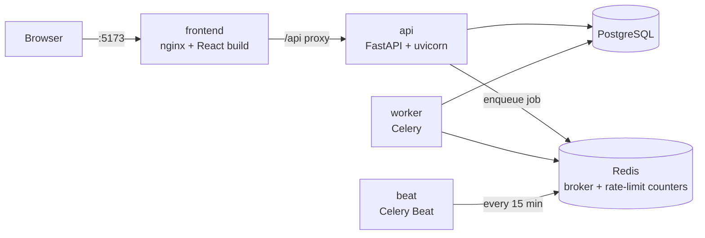

# Task Manager

A full-stack task management system: a **FastAPI** REST API built with Clean Architecture, a **React + TypeScript** frontend, **PostgreSQL**, and **Celery + Redis** for background jobs, all started with one `docker compose` command.

Users can create, read, update and delete tasks, assign them to teammates, mark them as completed, and filter them by status, due date and assignee. Assigning a task notifies the assignee in the background, and a scheduled job flags overdue tasks.

> Also in this repo: [PRESENTATION.md](PRESENTATION.md) (user story, thought process and architecture walkthrough) and [GENAI.md](GENAI.md) (how generative AI was used and validated).

---

## Quick start

Requirements: Docker with Compose v2.

```bash
docker compose up --build
```

| What | URL |
|---|---|
| Web app | http://localhost:5173 |
| API docs (Swagger UI) | http://localhost:8000/docs |
| Health check | http://localhost:8000/health |

**Demo credentials** (seeded automatically on first start):

| Email | Password |
|---|---|
| alice@example.com | demo1234 |
| bob@example.com | demo1234 |

The seed creates 12 tasks across all statuses, some overdue and some assigned between Alice and Bob. Log in as Alice, assign a task to Bob, then log in as Bob to see the notification.

Everything works without configuration. To override the demo defaults (database password, `JWT_SECRET`, host ports), copy `.env.example` to `.env` and edit it. **Set a real `JWT_SECRET` for anything beyond a local demo.** If port 8000 or 5173 is already taken on your machine, set `API_PORT` or `FRONTEND_PORT`.

To stop and wipe the demo database: `docker compose down -v`.

---

## Architecture



The backend follows Clean Architecture: dependencies point inward only.

```
backend/src/app/
├── domain/           Entities and business rules (Task, User, Notification). Pure Python, no framework imports.
├── application/      Use cases (TaskService, AuthService, NotificationService) and ports (Protocol interfaces).
├── infrastructure/   Adapters: SQLAlchemy repositories + unit of work, JWT, Argon2, Celery jobs, system clock.
└── api/              FastAPI routers, Pydantic schemas, dependency wiring (composition root), error mapping.
```

- `domain` imports nothing from the app; `application` imports only `domain`.
- Use cases depend on **ports** (`typing.Protocol`), so they are unit-tested with in-memory fakes, without a database.
- Domain errors (`NotFoundError`, `PermissionDeniedError`…) are mapped to HTTP status codes in one place (`api/errors.py`).

The frontend keeps each kind of state where it belongs: **server state** in TanStack Query, **filters and page** in the URL (shareable and reload-safe), **UI state** in components, and the **session** in an `AuthContext`. The browser only talks to its own origin; nginx (or Vite in development) proxies `/api` to FastAPI, so there is no CORS.

---

## API overview

All endpoints are under `/api/v1`, documented at `/docs`. In Swagger, click **Authorize** and use your email as the username.

| Method | Path | Description |
|---|---|---|
| POST | `/auth/register` | Create an account |
| POST | `/auth/login` | OAuth2 password flow → JWT access token |
| GET | `/users/me` | Current user |
| GET | `/users` | All users (for picking an assignee) |
| GET | `/tasks` | List with filters `status`, `due_after`, `due_before` (inclusive), `assignee_id`, and pagination `limit` (1–100) / `offset` |
| POST | `/tasks` | Create (optionally assigned) |
| GET | `/tasks/{id}` | Read one |
| PATCH | `/tasks/{id}` | Partial update: omitted fields are kept, `null` clears a nullable field |
| POST | `/tasks/{id}/complete` | Mark as done |
| DELETE | `/tasks/{id}` | Delete |
| GET | `/notifications` | Current user's notifications, newest first |

**Authorization rules:** every signed-in user can see the team board. The owner or the assignee can edit a task, and only the owner can delete it.

**Errors** use `{"detail": "..."}`: 401 (with `WWW-Authenticate: Bearer`), 403, 404, 409 (duplicate email), 422 (validation) and 429 (rate limit, with `Retry-After`).

---

## Key implementation decisions

| Decision | Why |
|---|---|
| FastAPI over Django | It keeps the domain free of ORM coupling, which is the Clean Architecture criterion. `Depends` gives dependency injection, and OpenAPI comes for free. |
| Sync SQLAlchemy 2.0 + Alembic | Simpler to test and to share with Celery, which is sync. Async brings no benefit at this scale, and the repositories isolate the choice. |
| Unit of Work, **commit before enqueue** | The Celery job is enqueued only after the transaction commits, so the worker never reads an uncommitted row. The next step would be a transactional outbox. |
| JWT access token (HS256, 60 min), Argon2id passwords | Meets the JWT requirement with a minimal surface. The secret must be ≥ 32 bytes, enforced at startup. |
| `limit`/`offset` pagination with `total` | Lets the UI show "page X of Y". Keyset pagination is the path for very large tables. |
| `due_date` is a calendar `date`, timestamps are UTC | A due date is a day, not an instant. This avoids timezone off-by-one bugs. |
| Rate limiting via `limits` + Redis | 100 req/min per IP on the API and 5 req/min on login/register. Counters are shared by all API replicas. Implemented as a dependency because slowapi's decorators bind config at import time. |
| Celery worker + beat | Assignment notifications are event-driven. Overdue detection is scheduled, idempotent, and also runs once at startup. |
| Tests: fakes for use cases, SQLite for integration | Fast feedback for TDD. Postgres-only behaviour is covered by the Docker run. |

More detail, including the trade-offs, is in [PRESENTATION.md](PRESENTATION.md).

---

## Local development (without Docker)

Backend (Python 3.12, [uv](https://docs.astral.sh/uv/)):

```bash
cd backend
uv sync
export JWT_SECRET=$(python -c "import secrets; print(secrets.token_urlsafe(48))")
uv run alembic upgrade head          # SQLite at ./dev.db by default
uv run python -m app.seed
uv run uvicorn app.api.main:create_app --factory --reload
```

Background jobs need Redis (`docker compose up -d redis`), then run `uv run celery -A app.infrastructure.worker.celery_app worker -l info`, plus `beat` in another terminal.

Frontend (Node 22+):

```bash
cd frontend
npm install
npm run dev        # http://localhost:5173, proxies /api to http://localhost:8000
```

---

## Tests and quality gates

```bash
cd backend && uv run pytest          # 105 tests, coverage gate 80% (currently ~97%)
cd backend && uv run mypy            # strict mode
cd backend && uv run ruff check . && uv run ruff format --check .
cd frontend && npm test -- --run     # Vitest + Testing Library
cd frontend && npm run lint && npm run build
```

- **Unit tests** (`backend/tests/unit`) cover the domain rules and use cases against in-memory fakes.
- **Integration tests** (`backend/tests/integration`) cover the repositories, every endpoint, auth edge cases (expired, malformed and orphaned tokens), rate limiting, the Celery job bodies and the seed.
- **pre-commit** runs ruff, mypy, oxlint and hygiene hooks on every commit: `uv run --project backend pre-commit install`.
- **GitHub Actions** runs all of the above and builds the Docker images on every push.

---

## Known limitations and next steps

- No refresh tokens or token revocation. Next: short-lived access token, rotating refresh token in an httpOnly cookie, and a `jti` denylist in Redis.
- The token is stored in `localStorage`. React escapes output and there is no `dangerouslySetInnerHTML`, but an httpOnly cookie would remove the XSS exposure.
- Enqueueing after commit can still lose a notification if Redis is down at that exact moment. A transactional outbox would guarantee delivery.
- Notifications use 30-second polling. WebSockets or SSE would make them real-time.
- "Overdue" uses the UTC date. Per-user timezones would make it exact around midnight.
- Integration tests run on SQLite. Testcontainers would run them on PostgreSQL in CI.
